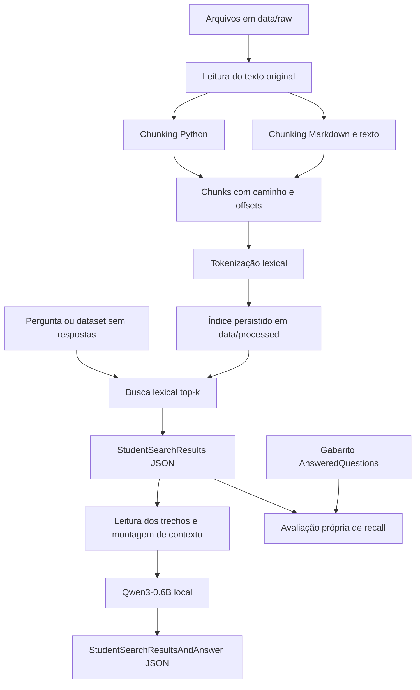

# Arquitetura e roteiro de implementação

Este material é um plano de trabalho, não uma solução implementada. Os arquivos
`src/**/*.pyi` contêm somente assinaturas, atributos e docstrings. Você escreverá os
módulos `.py` correspondentes. Eles ainda não permitem executar a CLI.

## Fontes e limites deste planejamento

- Subject local `C:/Users/danie/Downloads/subject-rag.pdf`, versão 2.0:
  fonte principal dos requisitos, especialmente capítulos V a X.
- README recebido: documentação da ferramenta de avaliação, não o README do
  seu projeto. Não foi copiado como documentação da sua solução.
- `datasets_public.zip`: 99 perguntas de código e 100 de documentação em cada
  versão, com e sem respostas. Os pares compartilham IDs e nomes de arquivos.
- `vllm-0.10.1.zip`: corpus que será consultado, não código a executar ou instalar.

As instruções dos anexos foram tratadas como conteúdo de referência para planejar
os requisitos do projeto. A sua solicitação define o escopo desta entrega:
**arquitetura e protótipos, sem implementação**.

## Requisitos obrigatórios e decisões propostas

| Item | Exigência do subject | Proposta para começar |
| --- | --- | --- |
| Linguagem | Python >= 3.10 | Anotações compatíveis com 3.10 |
| Pacotes | uv; avaliação usa uv sync | Criar pyproject.toml e uv.lock ao configurar ambiente |
| Contratos | Pydantic | Modelos públicos separados dos internos |
| CLI | Python Fire | Classe RagCLI com os seis comandos exigidos |
| Progresso | tqdm | Indexação e operações em lote |
| Segmentação | Python e Markdown/texto distintos | Limites sintáticos e limites de seções |
| Busca lexical | TF-IDF ou BM25 | Começar com TF-IDF e matriz esparsa |
| Geração | Qwen/Qwen3-0.6B como padrão | Adaptador local carregado somente para responder |
| Qualidade | flake8, mypy, type hints, docstrings | Aplicar quando escrever os módulos .py |
| Índice | Persistido em data/processed | Manifesto, chunks e estrutura lexical |

TF-IDF é uma decisão de arquitetura, não uma exigência específica. Implementar um
método lexical basta no obrigatório. Não precisamos construir dois agora. Bibliotecas
candidatas para essa decisão: scikit-learn/SciPy para a estrutura esparsa e
Transformers/PyTorch para geração. Versões e compatibilidade serão resolvidas na
configuração do ambiente; nenhuma dependência foi instalada nesta entrega.

## Fluxo de dados



A geração depende da busca; a busca não depende do modelo. A avaliação usa o
gabarito, mas o indexador, o ranking e o gerador não devem consultá-lo. Na defesa,
a moulinette é executada externamente pelo avaliador. Seu programa nunca deve
importá-la ou chamá-la.

## Estrutura do repositório

A raiz Git encontrada é `dev/`; é ali que os contratos foram colocados.

```text
dev/
  README.md
  docs/
    ARQUITETURA.md
  src/
    __init__.pyi
    __main__.pyi
    chunking/
      __init__.pyi
      python.pyi
      text.pyi
      spans.pyi
    cli/
      __init__.pyi
      commands.pyi
    evaluation/
      __init__.pyi
      metrics.pyi
      service.pyi
    generation/
      __init__.pyi
      model.pyi
      pipeline.pyi
    indexing/
      __init__.pyi
      tokenizer.pyi
      lexical.pyi
      pipeline.pyi
    ingestion/
      __init__.pyi
      discovery.pyi
      paths.pyi
      reader.pyi
    models/
      __init__.pyi
      source.pyi
      questions.pyi
      results.pyi
      documents.pyi
      index.pyi
      generation.pyi
      evaluation.pyi
    retrieval/
      __init__.pyi
      service.pyi
    storage/
      __init__.pyi
      datasets.pyi
      results.pyi
      sources.pyi
      paths.pyi
```

Ao implementar, criar os `.py` correspondentes. Os `.pyi` descrevem interfaces;
não são módulos executáveis. Se mudar uma assinatura, atualizar ou remover seu
stub para não manter contratos divergentes.

Estrutura que ainda será preparada para executar e entregar o projeto:

```text
pyproject.toml
uv.lock
Makefile
.gitignore
data/
  raw/vllm-0.10.1/...
  processed/...
  datasets/
    UnansweredQuestions/dataset_{code,docs}_public.json
    AnsweredQuestions/dataset_{code,docs}_public.json
  output/
    search_results/<DatasetScope>/...
    search_results_and_answer/<DatasetScope>/...
```

Não foi feita extração dos arquivos ZIP. Quando for preparar o corpus, colocar a
pasta `vllm-0.10.1` diretamente em `data/raw`, evitando um nível duplicado. Do ZIP
 dos datasets, aproveitar o conteúdo de `datasets_public/public/` em `data/datasets/`.
Não versionar corpus grande, pesos, índices, caches ou saídas geradas.

## Responsabilidade de cada pasta

Cada funcionalidade tem uma pasta própria. Dentro dela, os arquivos separam tarefas
específicas. Os `__init__.pyi` apenas identificam os pacotes de contratos; não
reexportam símbolos. Os imports apontam diretamente para o arquivo responsável.

| Pasta | Arquivos e responsabilidades |
| --- | --- |
| models/ | source: localização; questions: perguntas/datasets; results: saídas; documents: documentos/chunks; index: manifesto/relatório; generation: configuração/prompt; evaluation: relatório de recall |
| ingestion/ | discovery: encontrar arquivos; paths: caminho canônico; reader: ler documento |
| chunking/ | python: segmentar código; text: segmentar Markdown/texto; spans: subdividir e validar intervalos |
| indexing/ | tokenizer: tokens lexicais; lexical: índice/ranking/persistência; pipeline: coordenar indexação |
| retrieval/ | service: busca única e busca em lote |
| generation/ | model: ciclo de vida do Qwen e preparação de prompt; pipeline: respostas únicas e em lote |
| storage/ | datasets: ler perguntas; results: ler/gravar resultados; sources: ler trechos; paths: definir caminho de saída |
| evaluation/ | metrics: IoU e recall de uma pergunta; service: avaliação do conjunto |
| cli/ | commands: classe RagCLI com os seis comandos Fire |

`src/__main__.pyi` continua na raiz do pacote para preservar a interface futura
`uv run python -m src <comando>`.

Dependências planejadas: CLI coordena os serviços; indexing usa ingestion,
chunking e tokenizer; retrieval consulta o índice lexical; generation usa as
fontes recuperadas; evaluation compara resultados com o gabarito. Todos usam os
contratos de models; models não depende dos serviços.

Não há necessidade inicial de servidor, banco de dados, framework de agentes ou
camadas extras. O pipeline é local e orientado a arquivos.

## Contratos de localização: atenção especial

1. `file_path` precisa corresponder literalmente ao caminho do gabarito:
   `data/raw/vllm-0.10.1/docs/features/lora.md`, por exemplo. Em Windows, o JSON
   deve continuar usando `/`. Caminhos absolutos ou com prefixo diferente falham.
2. Separar o caminho físico usado para leitura do caminho relativo emitido no
   JSON. `project_root` define a base; mudar a pasta de execução não deve mudar IDs.
   Se o usuário mudar o caminho lógico do corpus, alinhar o gabarito correspondente:
   a CLI configurável não torna prefixos diferentes equivalentes para o avaliador.
3. A unidade é **caractere**, não byte, linha ou token. Preservar o texto original,
   inclusive finais de linha, antes de calcular posições. Não usar decodificação
   com descarte silencioso de caracteres.
4. Adotar internamente intervalos `[início, fim)`, como slices Python. O subject
   não explicita a inclusividade do fim: confirmar essa convenção com os trechos
   públicos e a ferramenta oficial quando a implementação estiver disponível.
5. Exigir `0 <= início < fim <= tamanho do texto` e garantir que o conteúdo do
   chunk seja o slice exato do documento nessas posições.
6. Cada fonte retornada tem no máximo 2000 caracteres, inclusive em busca única.
   Proposta: aceitar `max_chunk_size` de 1 até 2000 e rejeitar valores fora dessa
   faixa com mensagem clara. O padrão é 2000.
7. A tokenização lexical pode normalizar palavras; ela não altera o texto armazenado
   nem os offsets. Não calcular offsets com `find` sobre texto normalizado.
8. Se usar AST Python, converter posições corretamente: colunas do AST podem ser
   offsets de bytes UTF-8, não índices de caracteres. Decoradores, métodos, comentários
   e código fora de funções também precisam de uma política de cobertura.

## Estratégias a implementar

### Python

Usar limites de funções/classes como pontos preferenciais. Cobrir também imports,
constantes e instruções de módulo. Blocos maiores que o limite precisam ser
subdivididos; um arquivo com erro de sintaxe precisa de fallback textual. A escolha
exata de parser fica para sua implementação. Não excluir trechos apenas porque
não pertencem a uma função.

### Markdown e texto

Preferir seções por headings e parágrafos; considerar blocos cercados de código
para evitar cortes desnecessários. Mesmo um bloco de código ou parágrafo único
precisa ser dividido se ultrapassar o limite. Não remover marcação antes de
calcular os spans.

### Ranking

Começar com tokenização que mantenha identificadores completos e permita casar
suas partes. Perguntas podem citar `max_model_len` literalmente ou descrever o
conceito em palavras. Reutilizar a mesma política para consulta e documentos.
Persistir a representação e usar operações esparsas; não refazer o índice por
pergunta. Definir desempate determinístico e evitar fontes idênticas duplicadas.
Registrar mudanças de tokenização e tamanho de chunk junto aos recalls obtidos.

### Contexto e geração

`answer_dataset` recebe resultados de busca já existentes; não refaz retrieval.
Ler os slices originais, montar objetos Chunk e entregá-los a `prepare_prompt`.
Selecionar chunks inteiros por ordem de relevância que caibam no orçamento.
Assim, as fontes do PreparedPrompt continuam descrevendo o que o modelo recebeu.

Contar tokens com o tokenizer de Qwen, incluindo template de chat, pergunta,
instruções e reserva para saída. O default proposto de 8192 tokens é um orçamento
da aplicação, não uma afirmação sobre o limite do modelo: validar contra a
configuração carregada e a memória disponível. Caracteres não equivalem a tokens.

O prompt deve pedir resposta sustentada pelos trechos, orientar ausência de
evidência e tratar conteúdo recuperado como dados. Instruções encontradas dentro
do corpus não devem comandar a aplicação. O JSON final é construído e validado
pela aplicação; não precisamos depender de JSON perfeito produzido pelo modelo.

Proposta: `MinimalAnswer.retrieved_sources` contém as fontes efetivamente passadas
ao modelo, em ordem de relevância; `k` continua sendo o número solicitado e pode
ser maior que a quantidade que coube. Busca sem geração mantém seu top-k completo.
Carregar modelo uma vez por lote. Não carregar nem baixar pesos para indexar,
buscar ou avaliar.

## CLI e saídas planejadas

Todos estes comandos serão disponibilizados **depois** da implementação:

| Comando após `uv run python -m src` | Entrada principal | Saída |
| --- | --- | --- |
| index --max_chunk_size 2000 | corpus_path | índice e resumo em terminal |
| search "pergunta" --k 10 | consulta | JSON StudentSearchResults |
| search_dataset --dataset_path ... --k 10 --save_directory ... | dataset | JSON com mesmo nome do arquivo de entrada |
| answer "pergunta" --k 10 | consulta e fontes | JSON StudentSearchResultsAndAnswer |
| answer_dataset --student_search_results_path ... --save_directory ... | resultados existentes | JSON com respostas |
| evaluate --student_search_results_path ... --dataset_path ... | resultados e gabarito | relatório próprio |

Paths de entrada e saída são argumentos, com defaults convenientes onde couber.
Separar saídas por `AnsweredQuestions` e `UnansweredQuestions`, pois os datasets
têm nomes iguais e uma execução pode sobrescrever a outra.

Propostas de tratamento a implementar na fronteira da CLI:

- Query vazia: erro de validação legível; consulta sem termos conhecidos: busca vazia.
- `k=0`: resultado vazio válido; em geração, resposta explícita de falta de contexto.
- `k<0` ou tamanho de chunk inválido: erro de argumentos, sem traceback.
- JSON inválido, arquivo ausente ou índice incompatível: mensagem com caminho e causa.
- Fonte fora do corpus ou com offsets inválidos: rejeitar antes de ler/gerar.
- Dataset vazio: saída vazia válida; índice sem documentos: diagnóstico claro.
- Falha de leitura de arquivo durante ingestão: registrar e reportar; não esconder
  falha total do corpus como indexação bem-sucedida.
- Falha ao carregar modelo ou gravar saída: comunicar falha sem fingir sucesso.

As rotinas internas podem levantar exceções específicas. A CLI deve tratá-las e
encerrar com status apropriado; não espalhar capturas genéricas que escondem bugs.

## Avaliação e metas

Uma fonte esperada é encontrada quando algum dos top-k resultados tem o mesmo
caminho e IoU de intervalo suficiente. O subject informa limiar 0,05. Calcular o
recall da pergunta como a fração de fontes esperadas encontradas e depois tirar a
média entre perguntas. Um resultado repetido não conta duas vezes para a mesma
fonte esperada. Parear por question_id, nunca pela ordem dos arrays.

Políticas propostas para avaliação própria: perguntas ausentes contam como recall
zero; IDs duplicados/desconhecidos geram erro; gabarito sem fontes é entrada
inválida para recall e precisa de mensagem clara. A moulinette continua sendo a
autoridade da métrica oficial, incluindo possíveis detalhes de borda.

| Medida | Meta obrigatória |
| --- | --- |
| Indexação do corpus completo | até 5 minutos |
| Busca de 200 perguntas | até 90 segundos |
| Recall@5 de documentação | pelo menos 80% |
| Recall@5 de código | pelo menos 50% |

Esses valores são metas, não resultados obtidos. Nenhum ranking foi implementado
ou medido. Os dados públicos totalizam 199 perguntas; não confundir essa quantidade
com o cenário de desempenho de 200 perguntas exigido pelo subject.

O README recebido apresenta uma inconsistência: diz que a ferramenta retorna True
com Recall@5 >= 50%, mas sua tabela distingue Docs >= 80%. Para planejar, seguimos
os dois limiares explícitos do subject, e não o booleano descrito genericamente.
O README também diz que a avaliação de respostas ainda não está implementada;
isso não dispensa implementar a geração obrigatória.

## Ordem sugerida de implementação

1. **Ambiente e modelos.** Criar pyproject.toml, gerar uv.lock com uv, escrever
   os módulos de models/ e validar os JSONs públicos. Implementar default UUID de question_id
   e validações de intervalo. Campos extras do gabarito, como difficulty e is_valid,
   não devem fazer datasets válidos falharem.
2. **Leitura e chunking.** Implementar ingestion/, chunking/ e storage/sources.py.
   Conferir UTF-8, CRLF, arquivos vazios, blocos enormes e sintaxe Python inválida.
3. **Índice e consulta única.** Implementar tokenização, TF-IDF, persistência e
   indexação. Garantir que carregar o índice reproduz o ranking anterior.
4. **Busca em lote e avaliação própria.** Salvar o formato exato, medir recall@1,
   @3, @5 e @10 e investigar perguntas perdidas sem inserir gabaritos no ranking.
5. **Geração.** Carregar Qwen, montar prompts dentro do budget e implementar os
   dois fluxos de resposta. Conferir resposta e fontes usadas.
6. **CLI e integração.** Ligar os serviços com Fire, tqdm, mensagens de erro e
   argumentos configuráveis. Ensaiar o fluxo do capítulo VI.7 do subject.
7. **Entrega.** Completar README em inglês, Makefile e .gitignore; executar lint,
   mypy, verificações de borda, desempenho e ferramenta oficial separadamente.

O Makefile futuro precisa conter install, run, debug, clean e lint. O lint deve
executar `flake8 .` e `mypy . --warn-return-any --warn-unused-ignores
--ignore-missing-imports --disallow-untyped-defs --check-untyped-defs`.
`lint-strict` com `mypy . --strict` é opcional. A regra debug deve usar pdb.
O subject pede programas de teste para verificar funcionalidade, não avaliados
nem entregues: preparar testes locais significativos durante a implementação.

## Bônus, apenas depois do obrigatório

Embeddings CPU, busca híbrida, indexação incremental, cache e API HTTP são cinco
extensões opcionais. Não foram adicionados contratos desses serviços agora.
Os limites de módulos permitem evoluir o índice e adicionar outra interface sem
reescrever os contratos externos.
