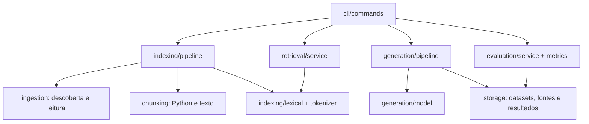

# Arquitetura e roteiro de implementação

Estrutura conferida com o subject RAG against the machine, versão 2.0,
especialmente capítulos V, VI, VII e VIII. O subject é referência de requisitos;
a divisão interna abaixo é uma decisão de organização do projeto.

Todos os módulos planejados para o obrigatório já existem como `.py`. Não é
necessário criar um arquivo novo para cada etapa deste roteiro. Os modelos e
o leitor estão implementados; os demais serviços têm protótipos executáveis que
levantam `NotImplementedError`. Isso sinaliza trabalho pendente, não uma solução
funcional. Para implementar, substitua esse `raise` pelo corpo da função.

## Fluxo e dependências



`models/` define os objetos trocados entre as etapas. Não importa serviços.
Busca e avaliação não carregam modelos gerativos. O gabarito é exclusivo da
avaliação: não alimentar o índice ou o ranking com respostas de referência.

## Mapa dos arquivos e ordem de trabalho

| Etapa | Arquivo em `src/` | Responsabilidade | Estado |
| --- | --- | --- | --- |
| Base | `models/source.py` | Caminho e intervalo de uma fonte | Implementado |
| Base | `models/documents.py` | Document, Chunk, RankedChunk | Implementado |
| Base | `models/questions.py` | Perguntas e datasets | Implementado |
| Base | `models/results.py` | JSONs públicos de busca e respostas | Implementado |
| Base | `models/index.py` | Manifesto e relatório do índice | Implementado |
| Base | `models/generation.py` | Configuração e prompt preparado | Implementado |
| Base | `models/evaluation.py` | Relatório de recall | Implementado |
| 1 | `ingestion/reader.py` | Ler texto sem alterar caracteres | Implementado |
| 2 | `ingestion/discovery.py` | Descobrir arquivos relevantes em ordem estável | Implementado |
| 3 | `ingestion/paths.py` | Centralizar caminho relativo POSIX | Implementado |
| 4 | `chunking/spans.py` | Subdividir intervalos e validar chunks | Implementado |
| 5 | `chunking/text.py` | Separar Markdown/texto por seções e parágrafos | Implementado |
| 6 | `chunking/python.py` | Separar código por limites sintáticos | Protótipo |
| 7 | `indexing/tokenizer.py` | Tokenização comum a documentos e consultas | Protótipo |
| 8 | `indexing/lexical.py` | Construir, consultar, salvar e carregar índice | Protótipo |
| 9 | `indexing/pipeline.py` | Coordenar ingestão, chunks e índice com tqdm | Protótipo |
| 10 | `storage/datasets.py` | Ler e validar datasets | Protótipo |
| 10 | `storage/paths.py` | Definir nome da saída de um dataset | Protótipo |
| 10 | `storage/results.py` | Ler resultados e gravar JSON sem arquivo parcial | Protótipo |
| 11 | `retrieval/service.py` | Busca única e por dataset, preservando IDs | Protótipo |
| 12 | `evaluation/metrics.py` | IoU e recall por pergunta | Protótipo |
| 12 | `evaluation/service.py` | Parear IDs e calcular médias de recall | Protótipo |
| 13 | `storage/sources.py` | Ler slices com caminho e offsets validados | Protótipo |
| 14 | `generation/model.py` | Carregar Qwen e preparar contexto no budget | Protótipo |
| 15 | `generation/pipeline.py` | Gerar respostas sobre resultados existentes | Protótipo |
| Gradual | `cli/commands.py` | Coordenar os seis comandos Fire | Protótipo |
| Entrada | `__main__.py` | Entrada `python -m src` | Somente status |

Os `__init__.py` identificam os pacotes. Os `.pyi` foram removidos para que
assinaturas não precisem ser mantidas em dois lugares. O leitor delega a `ingestion/paths.py` o cálculo do caminho relativo.

## Contratos que precisam ser preservados

- Ler UTF-8 sem transformar CRLF; offsets são caracteres, não bytes ou tokens.
- Usar caminhos relativos à raiz, com `/`, exatamente como no corpus/gabarito.
  Resolver caminhos e rejeitar escapes antes da leitura, inclusive por symlinks.
- Trabalhar internamente com intervalos `[início, fim)` e conferir essa convenção
  com a avaliação oficial. Cada chunk deve corresponder ao slice original.
- Aceitar tamanho de chunk configurável de 1 a 2000, padrão 2000; nenhuma fonte
  recuperada pode ultrapassar 2000 caracteres.
- Python e Markdown/texto precisam de estratégias distintas. Cobrir também
  imports, constantes, blocos enormes e Python com erro de sintaxe. Posições de
  colunas AST podem ser bytes UTF-8: não confundir com índices de caracteres.
- Implementar pelo menos TF-IDF ou BM25. Proposta inicial: TF-IDF esparso,
  tokenização compartilhada e desempate determinístico. Bibliotecas do índice
  serão selecionadas durante sua implementação.
- Persistir em `data/processed/`; carregar uma vez para buscas em lote.
- `answer_dataset` consome buscas já salvas, sem repetir retrieval. Carregar
  Qwen/Qwen3-0.6B uma vez por lote. Selecionar dependências de geração nessa etapa.
- Contar tokens com o tokenizer real, incluindo template e reserva de saída.
  Conteúdo recuperado é evidência, não instrução para executar ações.
- Construir o JSON final com os modelos Pydantic, preservando IDs e `k`.
- Na CLI, apresentar erros legíveis para arquivos ausentes, JSON inválido,
  consulta vazia, `k` negativo e índice incompatível. `k=0` pode retornar vazio.
- Usar tqdm em operações longas; manter Fire como interface da CLI.
- A avaliação própria usa IoU 0,05 no mesmo caminho e média por pergunta.
  Nunca importar ou chamar a moulinette a partir da aplicação.

## Interface final planejada

Todos os caminhos de entrada/saída são configuráveis pelos argumentos já
declarados em `cli/commands.py`.

| Comando após `uv run python -m src` | Entrada mínima |
| --- | --- |
| `index` | `--max_chunk_size` |
| `search` | query, `--k` |
| `search_dataset` | `--dataset_path`, `--k`, `--save_directory` |
| `answer` | query, `--k` |
| `answer_dataset` | `--student_search_results_path`, `--save_directory` |
| `evaluate` | `--student_search_results_path`, `--dataset_path` |

Conectar os comandos ao Fire conforme os serviços forem implementados, com
tratamento de erros na fronteira da CLI. Por enquanto apenas `status` é exposto.

## Diretórios e verificação

```text
data/raw/vllm-0.10.1/
data/processed/
data/datasets/AnsweredQuestions/
data/datasets/UnansweredQuestions/
data/output/search_results/<DatasetScope>/
data/output/search_results_and_answer/<DatasetScope>/
tools/moulinette/
tests/test_models.py
tests/test_reader.py
```

Corpus, datasets, índices, saídas e avaliadores ficam fora do Git. Os diretórios
locais já estão preparados. Os testes atuais estão prontos para receber novos
casos; arquivos adicionais de teste podem ser criados se ajudarem a organização.

Após cada implementação: verificar o comportamento e executar `make test` e
`make lint`. Passar esses checks enquanto os serviços são protótipos não
significa atender o obrigatório. As metas finais precisam de medição no corpus:
indexação até 5 minutos, 200 buscas até 90 segundos, Recall@5 de docs >= 80% e
de código >= 50%. Bônus ficam para depois do obrigatório.
